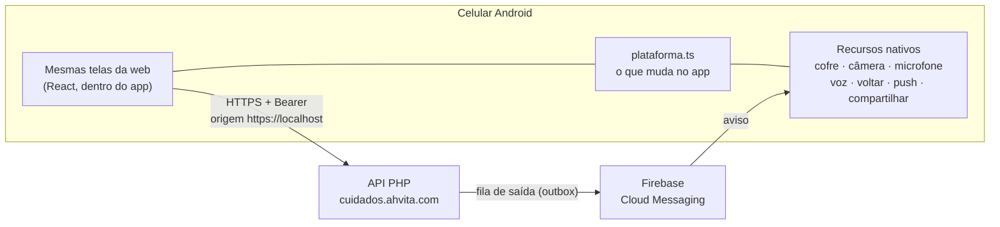

# App Android — Ahvita Cuidados

> Decisão (out/2026): o app Android usa **Capacitor**, que empacota **as mesmas telas React da web** num app nativo. Substitui o plano anterior com Expo (React Native), que reescreveria as ~40 telas e manteria duas interfaces. Web e Android ficam sempre iguais: uma mudança de tela vale para os dois.

| | |
|---|---|
| Identificador na Play Store | `com.ahvita.cuidados` (**permanente**: não pode mudar depois de publicado) |
| Android mínimo | 7.0 (API 24) — cobre praticamente todos os celulares em uso |
| Android-alvo | 16 (API 36), exigido pela Play Store desde 31/08/2026 |
| Código | `apps/web/` (telas) · `apps/web/android/` (projeto nativo) · `apps/web/capacitor.config.ts` |
| Build | GitHub Actions → **App Android** (`.github/workflows/android.yml`) |

## 1. Como funciona



As telas não sabem se estão na web ou no app. Tudo o que muda fica em `apps/web/src/plataforma.ts`:

| Tema | Web | App Android |
|---|---|---|
| Sessão | cookie `HttpOnly` | token Bearer no **cofre do aparelho** (Android Keystore), lido antes de abrir as telas |
| Endereço da API | mesmo domínio (`/api/…`) | `https://cuidados.ahvita.com/api/…` (variável `VITE_URL_APP`) |
| Fotos e áudios recebidos | `` com cookie | baixados com o token e mantidos **só na memória** (nada vai para a galeria) |
| Foto e áudio enviados | `<input capture>` e MediaRecorder | iguais: câmera e microfone pedidos **na hora de usar** |
| "Ouvir" (voz) | `speechSynthesis` | leitura nativa do Android (o WebView não tem voz) |
| Botão/gesto "voltar" | do navegador | navega dentro do app; nas telas iniciais, minimiza (como o WhatsApp) |
| Links externos (termos, WhatsApp, suporte) | nova aba | navegador do sistema / app certo |
| "Baixar uma cópia" (LGPD) | download | grava na pasta temporária do app e abre **Compartilhar** |
| Entrar com Google | botão do Google | **escondido**: o botão do Google não funciona dentro de apps. Entra por código (celular/e-mail) |
| Sem internet | fila no IndexedDB + service worker | fila no IndexedDB do app (as telas já estão no aparelho) |
| Avisos | consulta periódica com o app aberto | **push** com o app fechado (quando o Firebase estiver configurado) |
| Link de convite | abre a página | abre **direto no app** (depois do passo 4.4) |

## 2. Avisos no celular (push)

- O servidor já grava os eventos na fila de saída (`eventos_saida`). `Support/Push.php` lê a fila a cada minuto (dentro das tarefas automáticas) e envia pelo Firebase (API HTTP v1, conta de serviço; sem biblioteca).
- Eventos que geram aviso: **mensagem** nova na conversa, **pedido de atendimento** (proposta), **pedido de rede** da empresa, **pedido de acompanhamento** e **alertas** do painel (ex.: atendimento sem confirmação).
- O aparelho é registrado em `POST /dispositivos`, **preso à sessão**: sair da conta, encerrar sessões pelo painel ou excluir a conta desliga os avisos. Token recusado pelo Firebase é apagado.
- Antes da janela do Android pedir a permissão, o app mostra uma tela simples ("Avisos no celular — Sim, receber / Agora não"). Quem tem pouca prática costuma negar uma janela que aparece sem explicação.

**Regras de conteúdo e horário (LGPD e ⚖️ risco trabalhista)**
1. O texto do aviso **nunca** leva nome nem dado de saúde: aparece na tela bloqueada. Ex.: "Nova mensagem na conversa." Os avisos são marcados como privados no Android.
2. **Cuidador(a): silêncio das 21h às 7h** (Brasília), a menos que esteja **em serviço** ou tenha ligado **"Avisos à noite"** em *Eu*. Pedidos de atendimento esperam até as 7h; mensagens não tocam o celular nesse horário (aparecem ao abrir).
3. Textos sem cobrança: "Você recebeu um pedido de atendimento. Veja e decida se aceita." Nada de "responda", "prazo", "escala".
4. Mensagens da mesma conversa substituem o aviso anterior (não empilham).

> ⚖️ Por que o silêncio padrão: notificações de contratante a qualquer hora podem ser lidas como **subordinação e sobreaviso** (indícios de vínculo empregatício com MEI/autônomo). Com o silêncio padrão e a escolha nas mãos do(a) cuidador(a), o app reforça que **a agenda é dele(a)**.

## 3. Segurança e privacidade no aparelho

- `allowBackup=false` + regras de extração: dados do app **não vão** para o backup do Google nem para a cópia entre celulares.
- Token da sessão no cofre (Keystore). Ao sair: apaga token, fila, cópias e mídias da memória, e desregistra os avisos.
- Sem permissão de **localização** (o app não rastreia o(a) cuidador(a)).
- CORS: a API libera `https://localhost` **sem cookie** (`cors.origens_app`). O cookie da web nunca vale a partir do app.
- Só a pasta temporária do app pode ser compartilhada (FileProvider restrito).
- O painel `/admin` não vai para o app (fica só na web).

## 4. Passo a passo para publicar

### 4.1 Contas (fazer em nome da Ahvita, não de pessoa física)
1. **Google Play Console** com conta de **organização** (CNPJ + número D-U-N-S). Conta pessoal criada depois de 13/11/2023 exige teste fechado com 12 pessoas por 14 dias antes de publicar.
2. **Verificação de desenvolvedor**: desde 30/09/2026, no Brasil, só instala em celular certificado app de desenvolvedor verificado — **inclusive APK mandado por WhatsApp**. Registre `com.ahvita.cuidados` no Play Console logo no início.
3. **Firebase**: crie o projeto, adicione o app Android `com.ahvita.cuidados` e baixe o `google-services.json`.

### 4.2 Segredos no GitHub (Settings → Secrets and variables → Actions)
| Segredo | O que é |
|---|---|
| `GOOGLE_SERVICES_JSON` | conteúdo do `google-services.json` (liga o push no app) |
| `ANDROID_KEYSTORE_BASE64` | chave de **envio** (upload key) em base64 |
| `ANDROID_KEYSTORE_SENHA`, `ANDROID_CHAVE_ALIAS`, `ANDROID_CHAVE_SENHA` | senhas e apelido da chave |

Gerar a chave de envio (uma vez, guarde em cofre de senhas da empresa):
```bash
keytool -genkeypair -v -keystore envio.jks -alias ahvita -keyalg RSA -keysize 2048 -validity 10000
base64 -w0 envio.jks   # cole o resultado em ANDROID_KEYSTORE_BASE64
```
Na Play Store, ative o **Play App Signing**: a chave final fica com o Google, na conta da Ahvita; a de envio pode ser trocada se vazar.

### 4.3 Servidor (KingHost)
1. Firebase → Configurações do projeto → **Contas de serviço** → "Gerar nova chave privada". **Cole o conteúdo** do JSON em `push.fcm_credenciais`, dentro do `configuracao.php`. ⚠️ Não envie o `.json` solto por FTP: na KingHost a pasta privada pode ficar dentro da `www` e o nginx ignora o `.htaccess`; a chave da conta de serviço ficaria baixável.
2. Para os avisos saírem em até 1 minuto mesmo sem ninguém usando o app, configure o chamador externo da Etapa 7 de `PUBLICAR-KINGHOST.md` (cron-job.org em `POST /api/v1/sistema/tarefas`) **a cada 1 minuto**. Sem isso, saem na próxima vez que alguém usar o app ou o painel.
3. A migração `db/007_dispositivos.sql` aplica sozinha (tarefas automáticas).

### 4.4 Link de convite abrindo direto no app
Publique `https://cuidados.ahvita.com/.well-known/assetlinks.json` com a impressão digital SHA-256 da chave de **assinatura do app** (Play Console → Integridade do app → Assinatura do app):
```json
[{"relation":["delegate_permission/common.handle_all_urls"],
  "target":{"namespace":"android_app","package_name":"com.ahvita.cuidados",
            "sha256_cert_fingerprints":["AA:BB:…"]}}]
```
Sem esse arquivo, o link abre no navegador (a versão web), que também funciona.

### 4.5 Gerar e testar
- Actions → **App Android** → Run workflow. Em *Artifacts*:
  - `ahvita-cuidados-usb-N.apk`: só por cabo USB (Android Studio/adb), para a equipe técnica;
  - `ahvita-cuidados-piloto-N.apk`: assinado, para o **piloto com cuidadores(as)**;
  - `ahvita-cuidados-N.aab`: envie no Play Console, primeiro em **Teste interno**.
- Teste em 3 a 5 celulares de entrada (Samsung linha A, Motorola linha E, Xiaomi Redmi), incluindo um com 2–3 GB de RAM e Android 9 ou 10.

### 4.6 Ficha da Play Store
- **Declaração de apps de saúde** e seção **Segurança dos dados**: dados de saúde, fotos, áudios, contato e identificadores; criptografados em trânsito; exclusão pelo app (*Meus dados → Excluir minha conta*, igual na web).
- Política de privacidade: `https://cuidados.ahvita.com/privacidade.html`.
- Público: adultos. A pessoa cuidada pode ser criança, mas **quem usa o app** é adulto(a) (gestor(a), cuidador(a), Rede de Apoio).
- Categoria: Saúde e fitness / Medicina. Não é dispositivo médico: não diagnostica nem trata.

## 5. Desenvolvimento local

```bash
npm install
npm run build:android            # confere vocabulário + gera dist-android + sincroniza com o Android
npm run android:abrir -w apps/web  # abre no Android Studio (precisa do Android SDK e JDK 21)
```
Para testar no emulador contra a API local, gere com `VITE_URL_APP=http://10.0.2.2:8099` e acrescente `http://localhost` em `cors.origens_app` só no ambiente de teste.

## 6. Limites conhecidos e próximos passos

| Item | Situação |
|---|---|
| Entrar com Google no app | escondido; ligar com login nativo do Google (Credential Manager), que devolve o mesmo tipo de credencial que a API já confere |
| Lembrete de remédio com o app fechado | ainda não; usar notificação local agendada a partir de `lembretes.ts` |
| Celulares que "matam" apps (Xiaomi, alguns Samsung) | medir no piloto; se avisos atrasarem, usar prioridade alta só para alertas e orientar a liberar "sem restrição de bateria" |
| iOS | o mesmo projeto Capacitor gera iOS (`cap add ios`), precisa de Mac/Xcode e conta Apple |
| Desempenho em celular muito simples | medir no piloto; se a conversa travar, otimizar a lista (virtualização) antes de pensar em reescrever |
