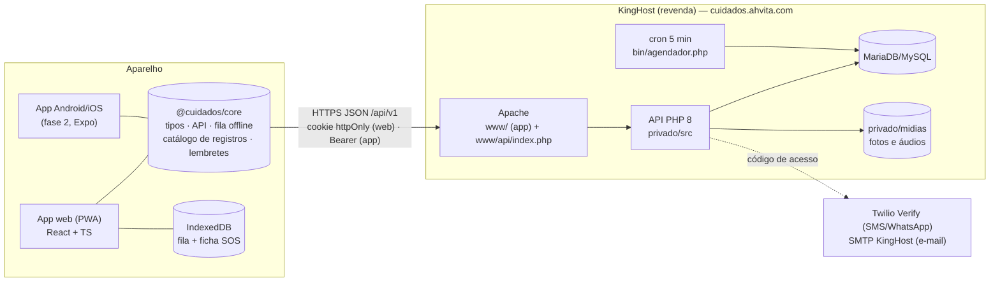
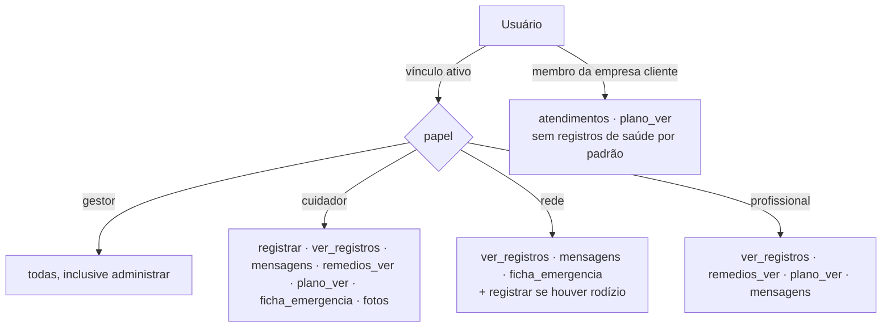

# Ahvita Cuidados — Arquitetura (MVP v2)

> Base: wireframe v5 completo (143 telas). Escopo do MVP: **Cuidador(a) — versão Conversa**, **Gestor(a) — funções básicas**, **Empresa — funções básicas**. Web responsiva (PWA) agora; Android/iOS previstos sem reescrever regras nem contrato da API.

## 1. Restrições que moldaram a arquitetura

| Restrição | Consequência no desenho |
|---|---|
| **KingHost, plano de revenda** (hospedagem compartilhada Apache + PHP + MySQL/MariaDB). O catálogo trata Node.js como produto separado. | API em **PHP 8.1+ sem dependências** (sem Composer): sobe por FTP, roda em qualquer plano compartilhado. |
| Banco da KingHost é **MariaDB** e recusa **gatilhos** (#1419) e **colunas geradas** (#1901) — visto na publicação anterior. | Esquema sem triggers, procedures, eventos ou colunas geradas. Regras (unicidade de vínculo, imutabilidade, auditoria) ficam na API. |
| Sem processo contínuo (nada de WebSocket/fila residente). | **Consulta periódica** (5 s com a conversa aberta, 15–30 s nos painéis) + **outbox** no banco, pronto para um serviço de tempo real futuro. |
| Cron disponível no painel, mas não garantido. | Alerta de cobertura roda no cron **e** ao abrir os painéis (correto mesmo sem cron). |
| Cuidador(a) com baixo letramento, celular simples, internet instável. | **Offline-first**: fila no aparelho, IDs gerados no aparelho (ULID), API idempotente; app instalável (PWA) que abre sem internet; bundle de 90 kB gzip. |
| Dados de saúde, inclusive de menores (LGPD arts. 11 e 14). | Autorização central por vínculo + permissão por funcionalidade; mídias fora da pasta pública; trilha de auditoria encadeada; exportação e exclusão no app. |

## 2. Visão geral



**Um app, modo por perfil**: o mesmo usuário pode ser cuidador(a) de uma pessoa e gestor(a) de outra. `GET /eu` devolve os papéis e o app abre `/c` (cuidador), `/g` (acompanhamento: gestor, Rede de Apoio, equipe de saúde) ou `/e/{id}` (empresa). Cada perfil tem **onboarding próprio** (`/bem-vindo/gestor|cuidador|empresa`), separado do app principal.

## 3. Camadas

### 3.1 `packages/core` (TypeScript puro, sem React e sem navegador)
Reaproveitado sem mudança no app Android/iOS.
- `tipos.ts` — contrato da API v1.
- `api.ts` — cliente HTTP (cookie na web, Bearer no app).
- `fila.ts` — fila offline com armazenamento trocável (IndexedDB na web; SQLite/AsyncStorage no app).
- `itens.ts` — catálogo dos registros de 1 toque da versão Conversa (9 principais + 10 em "Mais coisas"), com pronomes por sexo e faixas de alerta (febre, pressão, glicemia).
- `lembretes.ts` — doses do dia e água, calculados no aparelho (funcionam sem internet).
- `vocabulario.json` — termos proibidos (risco trabalhista/terminologia), usados no build.

### 3.2 `apps/web` (React 18 + Vite, PWA)
- Sem roteador nem biblioteca de estado externos: menos peso e menos manutenção.
- `telas/conversa/` é o coração: **o mesmo componente** atende o(a) cuidador(a) (modo grande, padrão WhatsApp) e o painel do(a) gestor(a).
- Service worker guarda só o app (nunca respostas da API: dado de saúde não fica no cache do navegador). A ficha de emergência e as últimas mensagens ficam no IndexedDB para o SOS funcionar sem internet; tudo é apagado ao sair.

### 3.3 `api` (PHP 8.1+, sem Composer)
```
public/index.php → Http\Kernel → Roteador → Modulos\*Controlador → Support\Bd (PDO)
```
- **Autoload PSR-4** próprio: dá para migrar para Composer/Slim/Laravel sem renomear classes.
- **`Modulos\Acesso`**: toda leitura/escrita de dados de uma pessoa passa por ele. Sem vínculo → 404 (não revela que a pessoa existe).
- **Validação** centralizada (`Support\Valida`) com erros por campo, prontos para a tela.
- **Idempotência**: registros, mensagens e presenças usam o ULID gerado no aparelho como chave (`INSERT IGNORE`).
- **Auditoria encadeada** (`Support\Auditoria`): cada linha guarda o hash da anterior; `bin/auditoria.php` acusa adulteração. JSON canônico para funcionar igual em MariaDB e MySQL 8.
- **Outbox** (`eventos_saida`): todo evento relevante (alerta, proposta) é gravado; hoje o cron limpa; amanhã um worker manda push/WhatsApp ou publica no WebSocket.

### 3.4 Banco
25 tabelas (detalhe em `docs/BANCO.md`). Datas em UTC; regras de agenda em `America/Sao_Paulo`. Registros clínicos são **imutáveis** (correção = novo registro que anula o anterior).

## 4. Autorização: vínculos e permissões por funcionalidade


O(a) gestor(a) liga/desliga cada funcionalidade por vínculo. `administrar` nunca vai para quem não é gestor(a). Os cinco **arranjos** ("Somente eu", só cuidador(a), gestor + cuidador(a), rodízio com a Rede, todos) são combinações de vínculos — nenhum código especial por arranjo.

## 5. Fluxos centrais

**Registrar (versão Conversa)**: ＋ → grade de 9 ícones → pergunta de 1 toque → aparece na conversa com 🕓 (no aparelho), ✓ (enviado) ou ✓✓ azul (quem acompanha viu). Febre, queda, dor e remédio recusado viram alerta no painel automaticamente (a API recalcula as faixas, não confia só no aparelho).

**Agenda do(a) cuidador(a)**: só ele(a) escreve na própria disponibilidade e bloqueios. Gestor(a) e empresa enviam **propostas**; para MEI/autônomo a API **recusa** proposta fora da disponibilidade (`409 fora_da_agenda`), e a tela avisa antes de enviar. Proposta da empresa vai a todos com disponibilidade; o primeiro aceite fica (UPDATE condicional atômico).

**Confirmação de ida**: prazo combinado por vínculo (padrão 60 min). Sem resposta no prazo → alerta neutro para gestor(a) e empresa organizarem cobertura ("sem resposta no prazo combinado" — sem falta, sem penalidade).

**Presença**: "Iniciar serviço" / "Finalizar" com resumo automático na conversa. O painel mostra só início e fim — sem totais de horas, atrasos ou ranking.

## 6. Segurança e LGPD
- Entrar por código de 6 dígitos (WhatsApp/SMS via Twilio Verify, ou e-mail SMTP), sem senha. Limites: 1 pedido/30 s por destino, 5/h por destino, 20/h por IP, 5 tentativas por código.
- Sessão por token opaco (só o SHA-256 no banco). Web: cookie `HttpOnly; Secure; SameSite=Lax` + cabeçalho obrigatório `X-Cuidados` em escrita (anti-CSRF). App: `Authorization: Bearer`.
- Fotos e áudios em `privado/midias`, fora da pasta pública; tipo conferido pelo conteúdo (finfo), não pela extensão; entregues só após checar permissão (`fotos` para fotos). Fotos reduzidas no aparelho (sem metadados de localização). Sem GPS em lugar nenhum.
- Consentimentos versionados (termos, dados de saúde, responsável legal de menor).
- Portabilidade (`/exportar`) e exclusão (`/excluir`) no app, para a pessoa cuidada e para a própria conta.
- HTTPS forçado, HSTS, `nosniff`, `no-referrer`, `X-Frame-Options: DENY`.

## 7. Escalabilidade: o que muda em cada fase

| Fase | Volume aproximado | Infra | O que muda no código |
|---|---|---|---|
| **1. Validação (agora)** | até ~300 pessoas cuidadas ativas | KingHost revenda (PHP + MariaDB) | nada |
| **2. Tração** | ~300 a 5 mil | KingHost Cloud/VPS: PHP-FPM + Nginx, MariaDB dedicado, Redis | Trocar a consulta periódica por **WebSocket** (serviço pequeno lendo o outbox); fotos/áudios em **armazenamento de objetos S3-compatível**; limite de tentativas no Redis; push nativo |
| **3. Escala** | > 5 mil | Nuvem gerenciada (GCP/AWS): contêineres, banco gerenciado com réplica de leitura | API sem estado já permite várias instâncias; leituras pesadas (painéis) em réplica; filas para notificações |

O que **já está pronto** para isso: API sem estado em memória, IDs ULID (sem depender de auto-incremento), clientes idempotentes, outbox, autorização num ponto só, contrato versionado (`/api/v1`) e core compartilhado.

**Gargalo conhecido da fase 1**: a consulta a cada 5 s. Com 100 conversas abertas ao mesmo tempo são ~20 requisições/s — dentro do que um plano compartilhado aguenta, mas é o primeiro ponto a migrar.

## 8. App Android/iOS (fase 2)
Ver `apps/mobile/README.md`. Expo (React Native) reutilizando `@cuidados/core`; token no SecureStore; fila no SQLite; câmera/microfone nativos; push (FCM/APNs) alimentado pelo outbox; prioridade Android (cuidador(a)).

## 9. Estrutura de arquivos
```
cuidados/
├─ api/                      API PHP (vai para privado/ na KingHost)
│  ├─ public/index.php       porta de entrada (vai para www/api/)
│  ├─ src/
│  │  ├─ bootstrap.php       autoload PSR-4 + configuração
│  │  ├─ Rotas.php           contrato v1 (62 rotas)
│  │  ├─ Http/               Kernel, Roteador, Requisicao, Resposta
│  │  ├─ Auth/               Sessao, Otp, Canais (Twilio/e-mail), Email (SMTP)
│  │  ├─ Support/            Bd (PDO), Valida, Tempo, Ulid, Auditoria, Config, ErroHttp
│  │  └─ Modulos/            Acesso, Permissoes, RegrasAgenda, Avisos, Conversas, Formata + controladores
│  ├─ bin/                   instalar, agendador (cron), auditoria, demo
│  ├─ config/                configuracao.exemplo.php
│  └─ tests/fluxo.php        teste de ponta a ponta (91 verificações)
├─ db/001_schema.sql         esquema (MariaDB/MySQL, sem triggers)
├─ packages/core/            regras e cliente compartilhados (web e app)
├─ apps/web/                 PWA React
│  └─ src/telas/
│     ├─ acesso/             Entrar, Código, Convite, Escolha de perfil
│     ├─ onboarding/         BemVindo, Gestor, Cuidador, Empresa (separados)
│     ├─ conversa/           Conversa, Registrar, SOS, useConversa
│     ├─ cuidador/           Conversas, Agenda, Eu, conversa com a empresa
│     ├─ acompanhamento/     Hoje, Linha do tempo, Remédios, Plano, Quem cuida, Atendimentos, Cadastro e privacidade
│     └─ empresa/            Painel, Atendimentos, Cuidadores(as), Clientes, Conversas
├─ apps/mobile/README.md     plano do app nativo
├─ scripts/                  verificar-termos (build falha com vocabulário de vínculo), empacotar-kinghost
└─ docs/                     este documento, API, banco, publicação, decisões e riscos
```
