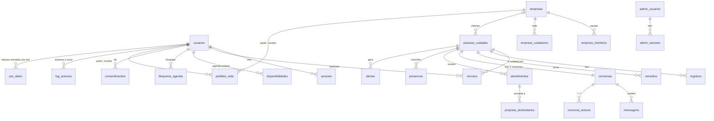

# Banco de dados — MariaDB/MySQL

Arquivos: `db/001_schema.sql` e as alterações seguintes `db/0NN_*.sql` (ex.: `002_google.sql`), aplicadas em ordem (importar no phpMyAdmin ou `php bin/instalar.php`). Compatível com MySQL 5.7+/8 e MariaDB 10.3+. Testado em MariaDB 10.11 com um usuário **sem** privilégio de gatilho (como na hospedagem compartilhada).

| Tabela | Para quê | Notas |
|---|---|---|
| `usuarios` | quem usa o app | CPF, telefone, e-mail e `google_sub` (conta Google) únicos; exclusão = anonimização; `bloqueado_em` (bloqueio pelo painel); `telefone_confirmado` (005: 0 = celular só informado, não serve para entrar) |
| `otp_codigos` | código de acesso | só o HMAC do código; tentativas; IP |
| `sessoes` | sessões | só SHA-256 do token |
| `empresas`, `empresa_membros`, `empresa_cuidadores` | empresa, equipe administrativa e rede de cuidadores(as) | `modalidade` (mei/autonomo/clt) decide a regra de agenda |
| `pessoas_cuidadas` | pessoa cuidada | `nascimento` obrigatório; `ficha` (emergência) e `plano` em JSON; `empresa_permissoes` definidas pelo gestor |
| `vinculos` | quem participa de cada cuidado | papel, relação (Tutor(a)…), modalidade, especialidade, `atua_como_cuidador`, `permissoes` JSON, `prazo_confirmacao_min` |
| `convites` | convites por código | 6 caracteres sem letras ambíguas; 7 dias |
| `disponibilidades`, `bloqueios_agenda` | **agenda do(a) cuidador(a)** | só o(a) próprio(a) escreve |
| `atendimentos`, `proposta_destinatarios` | propostas e combinados | `status`, confirmação de ida, `alerta_cobertura_em` |
| `presencas` | início/fim do serviço | sem cálculo de horas |
| `registros` | registros do cuidado | id do aparelho; imutável; `anulado_por`/`anula_id` |
| `remedios` | remédios e horários | `horarios` JSON |
| `conversas`, `mensagens`, `conversa_leituras` | conversa por pessoa + diretas empresa↔cuidador(a) | leituras para ✓✓ e não lidas |
| `midias` | fotos e áudios | arquivo fora da pasta pública; SHA-256 |
| `alertas` | painel do gestor e da empresa | único por (tipo, referência) |
| `consentimentos` | LGPD | termos, dados_saude, responsavel_legal, versionados |
| `auditoria` | trilha encadeada por hash | sem dado de saúde |
| `eventos_saida` | outbox | avisos no celular (push) saem daqui a cada minuto; base para WhatsApp/WebSocket; processados apagados após 30 dias |
| `dispositivos` | aparelhos do app que recebem avisos (`007`) | token do Firebase único; preso à sessão (`sessao_id`): sessão encerrada = aparelho apagado |
| `pedidos_cliente` | pedido de vínculo empresa ↔ pessoa cuidada, nos dois sentidos (`006`) | `origem` gestor/empresa; `pessoa_id` definida pelo(a) gestor(a) (ao pedir ou ao aceitar); `permissoes` liberadas ou pedidas; `chave_pendente` única; vence em 30 dias |
| `pedidos_rede` | pedido para entrar na rede de uma empresa, nos dois sentidos (`004_pedidos_rede.sql`) | `origem` empresa/cuidador; `status` pendente/aceito/recusado/cancelado/expirado; `chave_pendente` única garante 1 pendente por empresa + cuidador(a) sem gatilho; vence em 30 dias |
| `admin_usuarios` | equipe do painel `/admin` | e-mail + `google_sub` do 1º acesso; papel leitura/operador/dono (`003_admin.sql`) |
| `admin_sessoes` | sessões do painel | só o SHA-256 do token; 8 h, cai após 30 min parada |
| `log_acessos` | log de acessos e usos de todos os perfis e do painel | entradas/saídas, escritas, erros, exportações e tudo do painel; quem, perfil, rota (padrão), recurso, status, IP, aparelho; **sem corpo nem dado de saúde**; guarda ≥ 6 meses |
| `uso_diario` | leituras de rotina somadas por dia | (dia, usuário, perfil, rota, pessoa/empresa) → contagem; **sem horário** |
| `esquema_versoes` | migrações aplicadas | `bin/instalar.php` aplica só as novas |

**Migrações**: novos arquivos `db/002_*.sql`, `db/003_*.sql`… Cada um termina com `INSERT IGNORE INTO esquema_versoes`.

**Índices pensados para as telas mais usadas**: conversa (`registros(pessoa_id, recebido_em)`, `mensagens(conversa_id, recebido_em)`), linha do tempo (`registros(pessoa_id, tipo, ocorrido_em)`), agenda (`atendimentos(cuidador_id, inicio)`), cobertura (`atendimentos(status, inicio)`).
